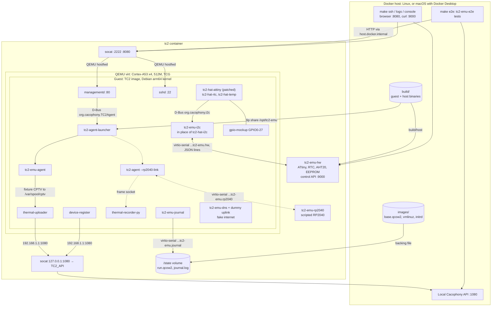
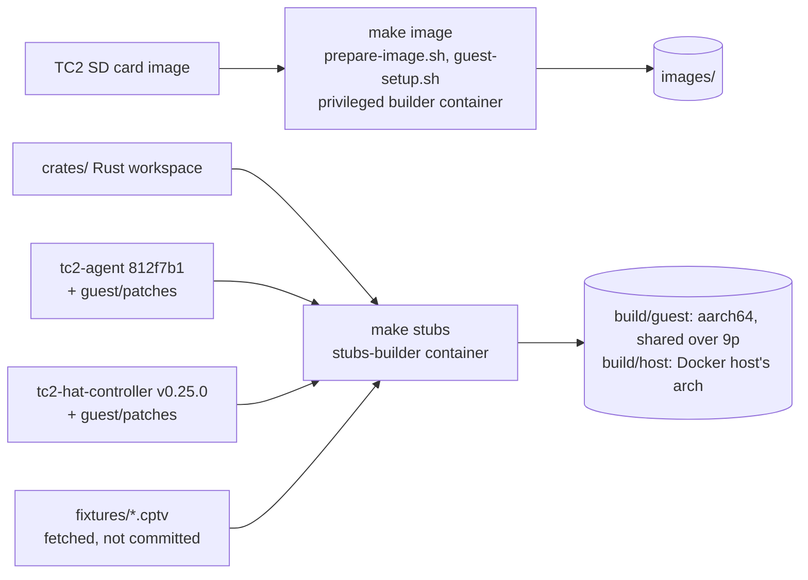

# tc2-emulator

Runs a TC2 thermal camera SD card image under QEMU in Docker, for end-to-end tests.

The Pi userspace runs unchanged on QEMU's `virt` machine (Cortex-A53, 4 cores,
512M to match the Pi Zero 2 W) with a Debian generic arm64 kernel, since the Pi
kernel has no virtio drivers. Pi/HAT hardware (SPI, I2C, GPIO, RP2040, ATtiny)
is not emulated.

## Architecture

Running (`make up`). Dashed parts are the real tc2-agent (`TC2_AGENT=real`);
otherwise the `tc2-emu-agent` stand-in serves tc2-agent's D-Bus interface.



Building:



## Usage

```sh
make image    # tc2-2026-02-03.img -> images/base.qcow2 + kernel (needs privileged docker)
make stubs    # build the tc2-emu-* binaries into build/ (also run by `make up`/`make run`)
make up       # boot in the background (or `make run` for the console in the foreground)
make ssh      # ssh pi@ the guest using images/id_ed25519
make console  # serial console; detach with ctrl-p ctrl-q
make logs     # follow the guest's systemd journal
make e2e      # fresh device + end-to-end tests against the API at localhost:1080
make down
```

Use a different source image with `make image SRC_IMG=path/to.img`.

- SSH: `localhost:2222`, management-interface: `http://localhost:8080`,
  hardware control API: `http://localhost:9000`
- Each run starts from a clean copy of `base.qcow2`. `TC2_PERSIST=1` keeps changes.
- `make image` registers an arm64 binfmt handler on the host kernel if missing
  (lasts until reboot). Arm64 hosts don't need one.

## macOS (Apple silicon)

Runs under Docker Desktop, where containers are arm64 Linux: the container's
binaries (`build/host`) are built for the Docker host's architecture, and the
guest is emulated with TCG as on Linux (no KVM either way). Not yet verified
on a Mac:

- `make image` needs privileged loop devices in Docker Desktop's VM. If that
  fails, build `images/` on Linux and copy it over (it's architecture-independent;
  keep `id_ed25519` with it).
- Builds bind-mount the repo, which is slower than on Linux.
- `make e2e` reaches the API and managementd at `host.docker.internal`, so the
  local Cacophony API must be published on the Mac's port 1080.

## Guest changes made by `make image`

See `scripts/guest-setup.sh`. In short:

- `device-register` registers with the test API instead of production (see below).
- `salt-minion`, `salt-updater`, swap, `rpi-eeprom-update` and `sshswitch` are
  disabled; add `tc2-emu.enable=<service>` to the kernel command line to enable one.
- The first-boot rootfs expansion in `rc.local` is skipped.
- Serial console autologin as `pi`, plus a test SSH key.
- `tc2-emu-journal` streams the journal to the container over a virtio-serial
  port, into `/state/journal.log` (the `tc2-state` volume). It's reset when the
  container starts and covers each guest boot from the start, so it works without
  SSH and keeps logs from a guest that hung or rebooted.

## Networking and the test API

The image configures `eth0` statically as `192.168.1.2/24` with no gateway. QEMU's
user network uses that subnet, with the host side at `192.168.1.1`. The guest has
no route to the internet, so it can't reach production servers.

`http://192.168.1.1:1080` in the guest is relayed to `TC2_API` (default
`host.docker.internal:1080`, i.e. port 1080 on the Docker host).

Services wait until modemd's connection check passes (ping 8.8.8.8/8.8.4.4 and
resolve google.com). The emulator answers it locally: a dummy interface holds
those addresses, and `tc2-emu-dns` (from `crates/`, in place of dnsmasq's DNS)
resolves every name to `192.168.1.1`. It answers other record types, AAAA
included, with no records straight away; dnsmasq forwarded those to unreachable
upstream servers, so every check waited 20s for them to time out.

## Registration

On a fresh device `device-register` runs (no `/etc/salt/minion_id` yet), registers
with the test API, writes `minion_id` as `pi-<device id>` and reboots. After that
`managementd` (the web UI) starts.

```sh
TC2_GROUP=my-group TC2_NAME=my-device make up   # TC2_NAME defaults to a random name
```

The group must already exist on the test API. Each run starts from a fresh disk
and registers a new device; use `TC2_PERSIST=1` to keep the registration.

## Emulated hardware

The Rust workspace in `crates/` stands in for the TC2 HAT:

- `tc2-emu-hw` runs in the container and models the devices on the HAT's I2C bus:
  the ATtiny power controller (0x25, firmware v1.0.9), PCF8563 RTC (0x51), AHT20
  temperature/humidity sensor (0x38) and the hardware EEPROM (0x50, power PCB v0.7.0).
- `tc2-emu-i2c` replaces `tc2-hat-i2c` in the guest. All TC2 software reaches the
  I2C bus through its `org.cacophony.i2c.Tx` D-Bus method, which it forwards to
  `tc2-emu-hw` over a virtio-serial port. The real `tc2-hat-attiny`, `tc2-hat-rtc`
  and `tc2-hat-temp` run unchanged on top.
- `tc2-emu-agent` replaces `tc2-agent` until it can talk to an emulated RP2040. It
  serves the `org.cacophony.TC2Agent` methods managementd uses, with tc2-agent's
  replies and status codes. A test recording goes through tc2-agent's status
  sequence, then saves `fixtures/cat-trigger.cptv` to `/var/spool/cptv` for
  thermal-uploader, with its header rewritten to the current time, this device's
  name and id, and the `test: true` motion config tc2-firmware writes for a
  user-requested recording. Audio recordings and preview frames aren't emulated yet.
- With `TC2_AGENT=real`, the guest runs the real `tc2-agent` instead (built from
  `main` with `guest/patches/tc2-agent`), talking to an emulated RP2040 over a
  second virtio-serial port (`--rp2040-link`). For now that's `tc2-emu-rp2040`, a
  scripted stand-in in the container: it makes the startup handshake (firmware 40),
  then streams flat frames. It can't make recordings yet; tc2-firmware's simulation
  will take its place.

Guest binaries are cross-compiled for `aarch64-unknown-linux-musl` and shared into
the guest at `/opt/tc2-emu` over 9p, so changing a stub needs `make stubs` and a
restart, not a new image.

Tests change the hardware through the control API:

```sh
curl localhost:9000/state
curl -X PATCH localhost:9000/attiny -H content-type:application/json -d '{"hv_battery_volts": 11.2}'
curl -X PATCH localhost:9000/aht20 -H content-type:application/json -d '{"temperature_celsius": 35}'
curl -X PUT localhost:9000/rtc/time -H content-type:application/json -d '{"time": "2027-01-01T09:00:00Z"}'
```

The ATtiny reports that the RP2040 wants the Pi on (`rp2040_wants_pi_on`) by
default. Without that, `tc2-hat-attiny` powers the Pi off once its startup grace
period ends and nothing else has asked it to stay on.

GPIO comes from `gpio-mockup` (see `guest/gpio-mockup/`): one chip at base 0, so
`GPIO0`-`GPIO27` match the Pi's numbering. Inputs are set through
`/sys/kernel/debug/gpio-mockup/gpiochip*/<line>` (the directory is `gpiochip1`, not
the sysfs `gpiochip0`). For example, the ATtiny signals the Pi by pulling GPIO16 low.

## Patched device software

Fixes the emulator needs before they're upstream live in `guest/patches/`.
`make stubs` builds the upstream version with them applied, and the guest runs
that build for the affected service only:

- `tc2-agent` `main` (`scripts/build-tc2-agent.sh`): `--rp2040-link <path>` talks to
  an emulated RP2040 over a socket instead of SPI and GPIO, and never programs it.
  The socket protocol is described in the patch's `src/rp2040_link.rs`.
- `tc2-hat-controller` v0.25.0, for `tc2-hat-attiny`: if GPIO16 can't be set up
  with a pull-up, set it up without one rather than reading an unopened pin, which
  always reads low and looks like a constant signal from the ATtiny. Off a real Pi,
  periph's sysfs GPIO driver can't set pulls. Its version reports as `0.25.0+tc2-emu`.

## End-to-end tests

`crates/tc2-emu-e2e` drives the device the way a user does, against a local
Cacophony API: it creates a user and group per test (as cacophony-web's e2e-tests
do), then uses managementd's HTTP API as Sidekick or the web UI would.
`new_device_setup` checks a new device registers into `new`, can be moved and
renamed into the user's group, and that a test recording reaches the API.

The tests are `#[ignore]`d so `cargo test` stays offline; `make e2e` starts a fresh
emulator and runs them. Set `TC2_E2E_API` / `TC2_E2E_MANAGEMENTD` to point elsewhere.
