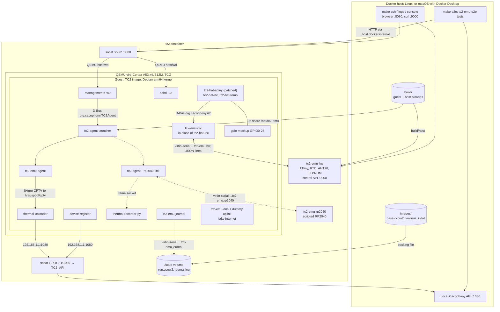
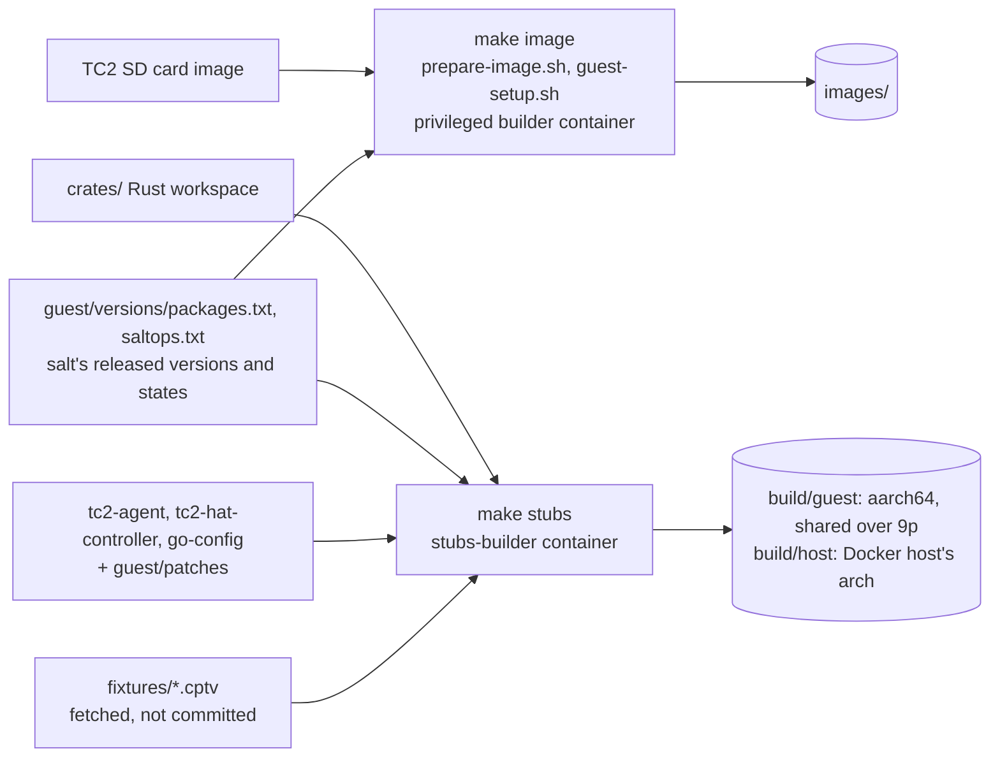

# tc2-emulator

Runs a TC2 thermal camera SD card image under QEMU in Docker, for end-to-end tests.

The Pi userspace runs unchanged on QEMU's `virt` machine (Cortex-A53, 4 cores,
512M to match the Pi Zero 2 W) with a Debian generic arm64 kernel, since the Pi
kernel has no virtio drivers. Pi/HAT hardware (SPI, I2C, GPIO, RP2040, ATtiny)
is not emulated.

## Architecture

Running (`make up`). Dashed parts are the real tc2-agent and the emulated RP2040,
the default; with `TC2_AGENT=stand-in`, the `tc2-emu-agent` stand-in serves
tc2-agent's D-Bus interface instead.



Building:



## Usage

```sh
make image    # tc2-2026-02-03.img -> images/base.qcow2 + kernel (needs privileged docker)
make stubs    # build the tc2-emu-* binaries into build/ (also run by `make up`/`make run`)
make up       # boot in the background (or `make run` for the console in the foreground)
make ssh      # ssh pi@ the guest using images/id_ed25519
make console  # serial console; detach with ctrl-p ctrl-q
make logs     # follow the guest's systemd journal
make e2e      # fresh device + end-to-end tests against the API at localhost:1080
make down
```

Use a different source image with `make image SRC_IMG=path/to.img`.

- SSH: `localhost:2222`, management-interface: `http://localhost:8080`,
  hardware control API: `http://localhost:9000` (the page there lists its routes)
- Each run starts from a clean copy of `base.qcow2`. `TC2_PERSIST=1` keeps changes.
- `make image` registers an arm64 binfmt handler on the host kernel if missing
  (lasts until reboot). Arm64 hosts don't need one.

## macOS (Apple silicon)

Runs under Docker Desktop, where containers are arm64 Linux: the container's
binaries (`build/host`) are built for the Docker host's architecture, and the
guest is emulated with TCG as on Linux (no KVM either way). Not yet verified
on a Mac:

- `make image` needs privileged loop devices in Docker Desktop's VM. If that
  fails, build `images/` on Linux and copy it over (it's architecture-independent;
  keep `id_ed25519` with it).
- Builds bind-mount the repo, which is slower than on Linux.
- `make e2e` reaches the API and managementd at `host.docker.internal`, so the
  local Cacophony API must be published on the Mac's port 1080.

## Guest changes made by `make image`

See `scripts/guest-setup.sh`. In short:

- The Cacophony software is updated to the versions salt deploys, pinned in
  `guest/versions/packages.txt`: release debs from GitHub, and `classifier-pipeline`
  from PyPI into its venv, as saltops installs them. The SD card image is older
  than what salt keeps devices on. `scripts/update-versions.sh [channel]` re-pins
  them from [salt-version-info](https://github.com/TheCacophonyProject/salt-version-info)
  (default `test`, to try releases before they reach prod devices; the image's
  own salt environment is `tc2-prod`); then `make image`.
- The rest of what salt deploys is applied too, by running a masterless highstate of
  the TC2 states from the [saltops](https://github.com/TheCacophonyProject/saltops)
  commit pinned in `guest/versions/saltops.txt` (the same commit `packages.txt` comes
  from) in the image's chroot: `guest/salt/apply-salt.sh`. That brings the older image
  up to date with the config files, models, test recordings and service enablement
  salt has added since, such as `thermal-recorder-py` running. There's no systemd in the
  chroot, so `guest/salt/fakebin` stands in for `systemctl` (enabling is real, starting
  is faked) and the commands it can't run, and the node group is left as `tc2-prod`. The
  build fails if a state fails that isn't in `guest/salt/expected-failures.txt`, or if a
  package would change version, which means `packages.txt` and `saltops.txt` have drifted.
- `man-db` and the manpages are purged, and `logrotate` first runs 5 minutes after boot
  instead of at boot (`logrotate.timer.d/tc2.conf`), so neither takes CPU while the system
  starts.
- `console-setup` is purged too (its udev rules set up each virtual console, ~1s of CPU at
  boot, for an HDMI console nobody uses).
- `ifupdown` and `nfs-common` are purged, and `eth0` is configured by a `tc2-emu-eth0`
  service instead of ifupdown. A TC2 uses neither (NetworkManager does the wifi and
  modem) and they cost ~7s of CPU at boot; the real image should drop them too.
- `device-register` registers with the test API instead of production (see below).
- `salt-minion`, `salt-updater`, `rpi-eeprom-update` and `sshswitch` are
  disabled; add `tc2-emu.enable=<service>` to the kernel command line to enable one.
- Swap is on, as on a TC2 (1GiB `/var/swap` from `dphys-swapfile`, swappiness 10). While
  we audit that nothing swaps on an SD card, `tc2-emu-swap-watcher` (emulator only) reports a
  `swapUsed` event, with the top swap users, when the kernel swaps pages out.
- The first-boot rootfs expansion in `rc.local` is skipped.
- Serial console autologin as `pi`, plus a test SSH key.
- `tc2-emu-journal` streams the journal to the container over a virtio-serial
  port, into `/state/journal.log` (the `tc2-state` volume). It's reset when the
  container starts and covers each guest boot from the start, so it works without
  SSH and keeps logs from a guest that hung or rebooted.

## An image for a real device

`make real-image` writes `images/tc2-real.img`, to put on an SD card for a real TC2 and
compare it with the emulator. It starts from the same SD card image and gets the same
software and changes (`scripts/guest-setup.sh` with `TC2_TARGET=device`): the pinned
package versions, the saltops highstate, the purges, the logrotate and `managementd`
socket-activation changes, and the same services disabled. It keeps the Pi's own kernel,
boot partition and first-boot rootfs expansion, and leaves out everything for QEMU. The
builds with `guest/patches` applied, all of them (including `tc2-agent` with the emulated
RP2040 link, which does nothing unless `--rp2040-link` is given), are installed over the
packages' binaries in `/usr/bin`.

1. `cp real-device.conf.example real-device.conf` and fill it in: the wifi network, and a
   **test** API the device can reach over it, such as this Mac's `cacophony-web` at
   `http://<this Mac's LAN address>:1080`. The build refuses a production URL. With no API
   the device doesn't register, so nothing contacts any API, but `managementd`, the
   uploader and config sync don't run either. The wifi password goes into the image.
2. `make real-image` (about 5 minutes). It also makes `images/real_ed25519`, whose public
   half is the only key the image adds for `pi`.
3. Write it to the card (16GB or more; it expands to fill the card on first boot, which
   reboots once). On macOS, with the card's disk number from `diskutil list`:
   `diskutil unmountDisk /dev/diskN && sudo dd if=images/tc2-real.img of=/dev/rdiskN bs=4m`
   (press ctrl-t for progress), or Raspberry Pi Imager's "Use custom".
4. Boot it. Once it has joined the wifi:
   `ssh -i images/real_ed25519 pi@tc2-image.local` (or its address). When it registers it is
   renamed; its new name is then `<device name>.local` too.

Salt's minion and updater are off, as in the emulator, so nothing updates the device or
contacts the production salt master (its minion is masterless, as the emulator's). To turn
a disabled service back on, add `tc2-emu.enable=<service>` to `cmdline.txt` on the card's
boot partition, which a Mac can edit. `modemd` and `rpi-net-manager` are on, as on a real
TC2; `modemd` restarts every 5s after registering if there's no modem. Only the CPU and
kernel differ from the emulator, and the hardware; the image hasn't been tried on one yet.

## Networking and the test API

The emulator's `tc2-emu-eth0` service configures `eth0` statically as `192.168.1.2/24` with no gateway
(the real image does it through ifupdown, which costs ~12s of boot here, so the emulator drops that
file). QEMU's
user network uses that subnet, with the host side at `192.168.1.1`. The guest has
no route to the internet, so it can't reach production servers.

`http://192.168.1.1:1080` in the guest is relayed to `TC2_API` (default
`host.docker.internal:1080`, i.e. port 1080 on the Docker host).

Services wait until modemd's connection check passes (ping 8.8.8.8/8.8.4.4 and
resolve google.com). The emulator answers it locally: a dummy interface holds
those addresses, and `tc2-emu-dns` (from `crates/`, in place of dnsmasq's DNS)
resolves every name to `192.168.1.1`. It answers other record types, AAAA
included, with no records straight away; dnsmasq forwarded those to unreachable
upstream servers, so every check waited 20s for them to time out.

## Registration

On a fresh device `device-register` runs (no `/etc/salt/minion_id` yet), registers
with the test API, writes `minion_id` as `pi-<device id>` and reboots. After that
`managementd` (the web UI) starts.

```sh
TC2_GROUP=my-group TC2_NAME=my-device make up   # TC2_NAME defaults to a random name
```

The group must already exist on the test API. Each run starts from a fresh disk
and registers a new device; use `TC2_PERSIST=1` to keep the registration.

## Emulated hardware

The Rust workspace in `crates/` stands in for the TC2 HAT:

- `tc2-emu-hw` runs in the container and models the devices on the HAT's I2C bus:
  the ATtiny power controller (0x25, firmware v1.1.0), PCF8563 RTC (0x51), AHT20
  temperature/humidity sensor (0x38) and the hardware EEPROM (0x50, power PCB v0.7.0).
- `tc2-emu-i2c` replaces `tc2-hat-i2c` in the guest. All TC2 software reaches the
  I2C bus through its `org.cacophony.i2c.Tx` D-Bus method, which it forwards to
  `tc2-emu-hw` over a virtio-serial port. The real `tc2-hat-attiny`, `tc2-hat-rtc`
  and `tc2-hat-temp` run unchanged on top. Its launcher then runs tc2-hat-i2c's
  startup EEPROM check (`tc2-hat-controller i2c eeprom`), which writes the
  `/etc/cacophony/eeprom-data.json` that `tc2-hat-attiny` reads battery settings from.
- The guest runs the real `tc2-agent` (built with `guest/patches/tc2-agent`),
  talking to an emulated RP2040 over a second virtio-serial port
  (`--rp2040-link`). The RP2040 is `tc2-firmware-emu`: the tc2-firmware release
  that tc2-agent ships, built on the firmware's mocked HAL with
  `guest/patches/tc2-firmware` (`scripts/build-tc2-firmware-emu.sh`). It runs in
  the container, is on the same I2C bus as the Pi (through `tc2-emu-hw`), and its
  Lepton holds the first frame of `fixtures/cat-trigger.cptv`. It records to its
  emulated flash and offloads to tc2-agent as on a device, and in high power mode
  streams frames for thermal-recorder. Outside its recording window it has the Pi
  power off; the e2e tests set an always-on window to keep it up. QEMU runs with
  `-no-shutdown`, so a powered off guest leaves the container running with the
  Pi's power cut, as the ATtiny does, and `tc2-emu-hw` resets the guest (a power
  on) when the RP2040's request for the Pi (ATtiny register 0x05 bit 0) is set again
  after the shutdown. `PATCH /attiny` with `rp2040_wants_pi_on` does the same by hand.
  When the firmware tells the ATtiny to power it down (register 0x05 = 2, once the Pi
  is off and it's outside its window), `tc2-emu-hw` models the PCF8563's alarm and
  keeps the RP2040 off the I2C bus until the RTC reaches it, so the firmware restarts
  and wakes the Pi at its next recording window as on a device. With time warp
  (`TC2_TIME_WARP=1`, or `PUT /time-warp` on the control API at port 9000) the RTC
  jumps to the alarm as soon as both the Pi and the RP2040 are off, rather than
  waiting for it. `TC2_START_TIME=HH:MM` (UTC) starts the RTC at the next such
  time of day from now (never behind real time, as the API files recordings by their
  time), and `make e2e` sets it from `E2E_START_TIME` (default 00:00,
  midday in NZ) so the tests don't depend on the time of day they run at.
  `TC2_RP2040=scripted` runs `tc2-emu-rp2040`, a scripted stand-in that
  only makes the startup handshake and streams flat frames, instead.
- With `TC2_AGENT=stand-in`, `tc2-emu-agent` replaces `tc2-agent`. It serves the
  `org.cacophony.TC2Agent` methods managementd uses, with tc2-agent's
  replies and status codes. A test recording goes through tc2-agent's status
  sequence, then saves `fixtures/cat-trigger.cptv` to `/var/spool/cptv` for
  thermal-uploader, with its header rewritten to the current time, this device's
  name and id, and the `test: true` motion config tc2-firmware writes for a
  user-requested recording. Audio recordings and preview frames aren't emulated,
  and `new_device_setup`'s Sidekick-style test recording fails with it, as it stops
  streaming when the config changes.

Guest binaries are cross-compiled for `aarch64-unknown-linux-musl` and shared into
the guest at `/opt/tc2-emu` over 9p, so changing a stub needs `make stubs` and a
restart, not a new image.

Tests change the hardware through the control API:

```sh
curl localhost:9000/state
curl -X PATCH localhost:9000/attiny -H content-type:application/json -d '{"hv_battery_volts": 11.2}'
curl -X PATCH localhost:9000/aht20 -H content-type:application/json -d '{"temperature_celsius": 35}'
curl -X PUT localhost:9000/rtc/time -H content-type:application/json -d '{"time": "2027-01-01T09:00:00Z"}'
```

The ATtiny reports that the RP2040 wants the Pi on (`rp2040_wants_pi_on`) by
default. Without that, `tc2-hat-attiny` powers the Pi off once its startup grace
period ends and nothing else has asked it to stay on.

GPIO comes from `gpio-mockup` (see `guest/gpio-mockup/`): one chip at base 0, so
`GPIO0`-`GPIO27` match the Pi's numbering. Inputs are set through
`/sys/kernel/debug/gpio-mockup/gpiochip*/<line>` (the directory is `gpiochip1`, not
the sysfs `gpiochip0`). For example, the ATtiny signals the Pi by pulling GPIO16 low.

## Patched device software

Fixes the emulator needs before they're upstream live in `guest/patches/`.
`make stubs` builds the upstream version with them applied, and the guest runs
that build for the affected service only. Released software is patched at the
version in `guest/versions/packages.txt`, so it matches the rest of the image:

- `tc2-agent` (`scripts/build-tc2-agent.sh`): `--rp2040-link <path>` talks to
  an emulated RP2040 over a socket instead of SPI and GPIO, and never programs it
  or erases its flash (the package's postinst requests an offload + erase; the
  offload still happens).
  The socket protocol is described in the patch's `src/rp2040_link.rs`. It's built
  with the tc2-firmware release its release workflow sets, whose firmware version
  `tc2-emu-rp2040` must report (`FIRMWARE_VERSION`).
- `tc2-hat-controller`, for `tc2-hat-attiny`: if GPIO16 can't be set up with a
  pull-up, set it up without one rather than reading an unopened pin, which always
  reads low and looks like a constant signal from the ATtiny. Off a real Pi,
  periph's sysfs GPIO driver can't set pulls. Its version reports as `<version>+tc2-emu`.
  It's built with the ATtiny firmware version its release workflow sets, which
  `tc2-emu-hw` must report (`FIRMWARE_VERSION` in `attiny.rs`).
- `go-config`, for `cacophony-config-sync`: when the device in the config file
  changes, as reregistering through Sidekick does, authenticate as the new device.
  Otherwise it carries on syncing settings with the old one until it restarts.
- `device-register` (`scripts/build-device-register.sh`), with `go-api`: after
  registering, `--start-services` starts what a reboot would, rather than
  rebooting. That's the services systemd skipped at boot because the device wasn't
  registered (they need `/etc/salt/minion_id`), and those waiting to restart after
  failing for that reason, such as `cacophony-config-sync`. Meanwhile it sets the
  salt grains (`salt-call --local`), which go-api can't for a new device, as it
  tries before there's a minion ID; salt-minion and salt-updater start once
  they're set. go-api sets the running
  hostname and restarts avahi-daemon so mDNS advertises the new name, which also
  applies when managementd reregisters the device.

## End-to-end tests

`crates/tc2-emu-e2e` drives the device the way a user does, against a local
Cacophony API: it creates a user and group per test (as cacophony-web's e2e-tests
do), then uses managementd's HTTP API as Sidekick or the web UI would.
`new_device_setup` checks a new device registers into `new`, can be moved and
renamed into the user's group, and that a test recording reaches the API.
`config_sync` checks cacophony-config-sync carries the power mode, recording window
and audio recording mode from the web portal to the device and back. It needs the
`go-config` patch above: without it, the sync still uses the old device's
credentials after reregistering. The tests share the one device, so `make e2e`
runs them in turn, `new_device_setup` first (`E2E_TESTS` in the Makefile).

`classify` checks the on-device classifier: it loads its models (and serves them on
127.0.0.1:8123) only while comms is enabled, which sets `[thermal-motion]
run-classifier`, then classifies the test recordings salt installs in
`/var/spool/cptv/test-recordings` (about a minute each on the emulated Pi). It runs
`pi_classify` in the guest over SSH (`TC2_E2E_SSH`, `TC2_E2E_SSH_KEY`, set by `make e2e`).
The image has `/label_paths.json` baked in: classifier-pipeline otherwise downloads it
from GitHub the first time it loads a model, and the emulated device has no internet.

The tests are `#[ignore]`d so `cargo test` stays offline; `make e2e` starts a fresh
emulator and runs them. Set `TC2_E2E_API` / `TC2_E2E_MANAGEMENTD` to point elsewhere.
